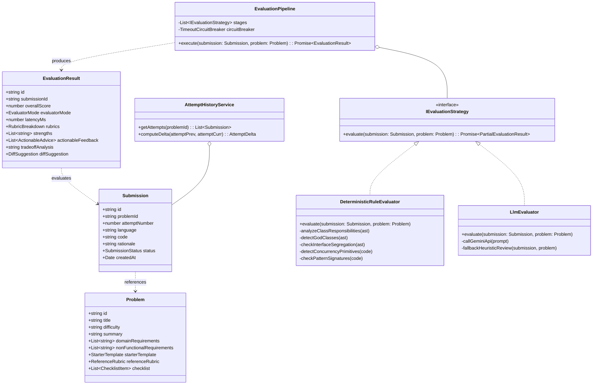

# Design Note: LLD Practice Platform Architecture & Domain Model

**Author:** Staff Systems / Platform Engineer  
**Date:** October 2026  
**Document Status:** Approved for Implementation

---

## 1. System Overview & Scope

The **LLD Forge Platform** is a specialized, lightweight learning environment dedicated to Low-Level Design (OOD/LLD) practice. It facilitates the continuous loop:
$$\text{Choose Problem} \longrightarrow \text{Model \& Code} \longrightarrow \text{Submit} \longrightarrow \text{Rubric Feedback} \longrightarrow \text{Attempt History \& Iteration}$$

Rather than building an over-engineered microservices cluster or an enterprise LMS, the system adopts a clean, modular monolith design with strict separation of domain entities, evaluation strategies, and presentation logic.

---

## 2. Core Domain Model (Classes & Interfaces)

The domain model follows Clean Architecture principles with decoupled boundaries:



### Key Domain Entities
1. **`Problem`**: Represents a design challenge (e.g. *Smart Multi-Level Parking Lot*, *Elevator Dispatcher*, *Distributed Rate Limiter*, *State-Driven Vending Machine*). Encapsulates requirements, constraints, starter templates, and evaluation criteria.
2. **`Submission`**: A learner's attempt snapshot containing source code, architectural rationale (trade-offs), and submission state machine (`DRAFT`, `SUBMITTED`, `EVALUATING`, `COMPLETED`, `DEGRADED`, `FAILED`).
3. **`EvaluationResult`**: Structured report containing overall score ($0-100$), multi-dimensional rubric breakdown (SOLID, Extensibility, Concurrency, Edge Cases), actionable next steps, and trade-off commentary.
4. **`AttemptHistory`**: Aggregates all submissions for a problem and computes deltas (score increases, smell removals, pattern additions) to support deliberate practice.

---

## 3. Evaluation Engine: Hybrid Pipeline & Strategy Pattern

### The Evaluation Dilemma
- **Pure LLM:** High reasoning, but unpredictable scoring consistency, potential timeouts, and vendor costs.
- **Pure Static Rules:** Predictable and sub-50ms fast, but lacks qualitative domain understanding and cannot assess prose trade-offs.

### The Hybrid Pipeline Solution
We implement an asynchronous `EvaluationPipeline` comprising sequential and fallback strategies:

```
[Incoming Submission]
         │
         ▼
[Stage 1: Structural Parser & Normalizer]
         │  (Extracts class contracts, method signatures, imports, patterns)
         ▼
[Stage 2: Deterministic Rule Evaluator] (~30ms)
         │  - Checks contract completeness
         │  - Detects God Class / Fat Interface smells (>8 public methods)
         │  - Verifies presence of Concurrency primitives (Mutex, Atomic, Synchronized)
         │  - Checks error/exception handling
         ▼
[Stage 3: LLM / Semantic Reasoning Evaluator] (with 5-second Circuit Breaker)
         │  - Examines design cohesion & domain abstraction naming
         │  - Critiques learner's stated architectural trade-offs
         │  - Synthesizes empathetic, mentor-grade actionable feedback
         ▼
  [LLM Succeeded?] ──► YES ──► [Synthesize Composite Rubric]
         │
         NO (Timeout / Error / No Key)
         │
         ▼
  [Graceful Degradation: High-Fidelity Heuristic Fallback Engine]
         │  (Tags result as DEGRADED_FALLBACK; returns complete rubric immediately)
         ▼
[Stage 4: Attempt Comparator & Delta Generator]
         │  (Calculates +N point improvement against prior attempt)
         ▼
[Completed EvaluationResult Stored in Repository]
```

---

## 4. Addressing Core Design Questions

### Question 1: What does a learner actually need to provide?
A meaningful LLD attempt requires three intertwined artifacts:
1. **Domain Code / Class Skeleton:** Interfaces, abstract classes, concrete implementations, and fields/methods.
2. **Primary Workflow Orchestration:** The dynamic behavior showing how components interact during core operations (e.g., `parkVehicle(car)` or `stepFloor()`).
3. **Architectural Rationale:** A dedicated input where the learner documents *why* they chose a pattern and what trade-offs they accepted.

### Question 2: What makes feedback useful when multiple designs are valid?
- **Rubric-Driven, Not Exact-Match:** Evaluates principles (Open-Closed, Single Responsibility, High Cohesion, Low Coupling) rather than matching an arbitrary "gold standard" solution.
- **Trade-off Education:** Explicitly validates that choices have trade-offs. For example, a state machine implemented via an `enum` is noted as lightweight and fast, but highlighted for its coupling if new states are frequently added.
- **Iterative Diffs:** Shows what specific line or abstraction changed between Attempt 1 and Attempt 2, rewarding deliberate refactoring.

### Question 3: Which parts are deterministic vs. LLM?
- **Deterministic:**
  - Presence of core entities (`Ticket`, `Spot`, `Gate`, `Vehicle`).
  - Method counts and cyclomatic complexity warnings.
  - Concurrency safety primitive detection.
  - Interface separation (checking if clients depend on methods they don't use).
- **LLM / Semantic:**
  - Semantic quality of names (e.g., `CarParkProcessor` vs `ParkingLotManager`).
  - Appropriateness of the design pattern to the specific requirements.
  - Qualitative suggestions on extensibility and clean code aesthetics.

### Question 4: How will the design accommodate new formats/evaluators?
- We define `IEvaluationStrategy` with a simple contract: `evaluate(submission, problem): Promise<PartialEvaluationResult>`.
- To add a **Docker Sandbox Execution Evaluator** or an **AST Roslyn Parser**, one simply implements `IEvaluationStrategy` and registers it in `EvaluationPipeline.registerStrategy(new DockerSandboxEvaluator())`.
- To support **Mermaid Class Diagram Submissions**, we implement `IMermaidSubmissionParser` that normalizes diagrams into our standard `DesignAstNode` tree before pipeline execution.

### Question 5: What happens if evaluation takes time or fails?
- **Practical Asynchronous Lifecycle:** Submissions enter `EVALUATING` state.
- **Circuit Breaker:** The LLM call has a strict 5000ms timeout.
- **Zero-Failure Fallback:** If the network drops or API quota is exhausted, the deterministic engine fulfills the evaluation with zero delay, setting `evaluatorMode = 'DETERMINISTIC_FALLBACK'`. The learner receives a non-blocking toast and full feedback without interruption.

---

## 5. Architectural Trade-offs & Decisions

| Decision | Chosen Approach | Alternative Considered | Rationale |
| :--- | :--- | :--- | :--- |
| **System Boundary** | Modular Monolith with In-Memory / LocalStorage Persistence | Microservices + Postgres + Redis queue | Focuses 100% on domain design and learner feedback journey without operational cloud overhead. |
| **Submission Input** | Multi-faceted practice canvas (Code + Rationale + Live UML) | Interactive drag-and-drop node graph | Professional LLD interviews and real-world work revolve around code and written trade-offs, not diagram canvas clicking. |
| **Evaluation Model** | Composite Pipeline (Deterministic first, LLM overlay, fallback safety) | Pure LLM prompt endpoint | Guarantees reliability, deterministic baseline scores, and immunity to API downtime. |
| **Language Support** | Polyglot syntactic parser (TypeScript, Java, Python, C++) | Single language only | Allows candidates to practice in their interview language of choice while sharing uniform rubric evaluation. |
